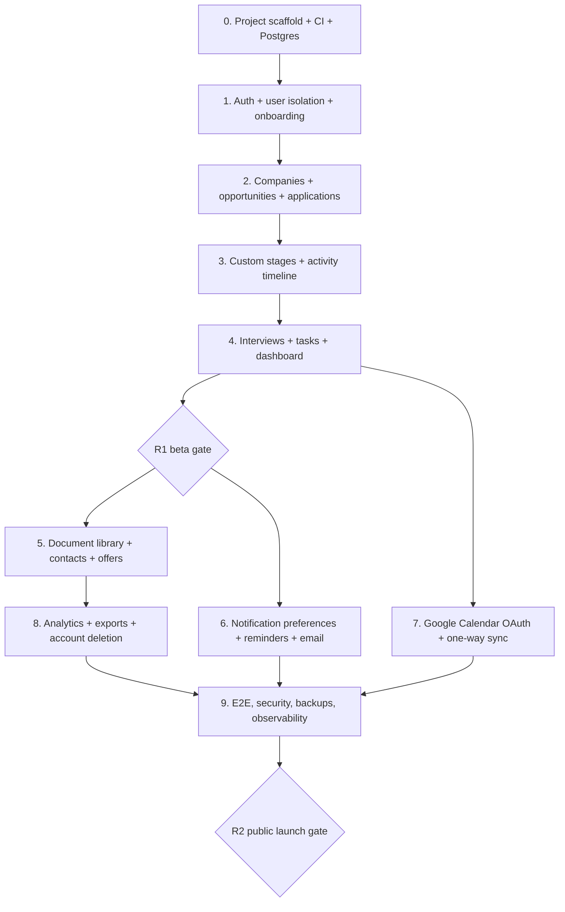

# Job Tracker — Development Backlog & Implementation Order

**Legend:** P0 = blocks MVP; P1 = required for public feature-complete R2; P2 = later optimization. Estimates are **relative story points** (1 small, 3 medium, 5 substantial, 8 complex) and should be re-estimated after technical spikes. Rows marked R1/R2 follow the PRD release boundaries.

## Build sequence / dependency graph

**Implementation target:** Next.js 16, Prisma ORM 7, Better Auth, PostgreSQL, Graphile Worker, private R2 storage; deploy through Docker Compose on Coolify, with PostgreSQL as a separate Coolify resource.

**Critical vertical slice:** Register -> save job -> submit application -> change stage -> schedule interview -> follow-up task -> dashboard. Complete this before building external providers.

## Milestone 0 — Engineering foundation

| ID | Priority | Points | User story / engineering task | Definition of done | Depends |
|---|---|---:|---|---|---|
| INF-01 | P0 | 3 | Initialize Next.js App Router + TS + Tailwind + shadcn/ui with lint/typecheck | Dev build, formatting, aliases, protected env separation run locally | — |
| INF-02 | P0 | 3 | Configure PostgreSQL + Prisma 7/adapter-pg and migration workflow | CI runs migration validation against disposable test database; migration files committed | INF-01 |
| INF-03 | P0 | 3 | Establish tests and CI/CD | Vitest, Playwright and CI build/typecheck/migration job run on PR | INF-01 |
| INF-04 | P0 | 2 | Configure environment/secret management and logging | Secrets never committed; errors carry correlation ID with PII redaction | INF-01 |

**Exit:** An empty but deployable authenticated-app skeleton, repeatable DB migrations and CI checks.

## Milestone 1 — Authentication, account and tenancy

| ID | Priority | Points | Story | Acceptance criteria | Depends |
|---|---|---:|---|---|---|
| AUTH-01 | P0 | 5 | Email/password registration, sign-in, verification, reset | Unverified users cannot use features requiring verified email; reset flow works; no user enumeration | AUTH-02 |
| AUTH-02 | P0 | 3 | Better Auth schema generation and current adapter configuration | Generated auth models match installed version; `auth check schema` passes | INF-02 |
| AUTH-03 | P0 | 5 | Session guard + owner-scoped DAL | A user cannot read/update/delete another user's IDs even via direct HTTP calls | AUTH-01 |
| AUTH-04 | P0 | 3 | First-login onboarding: timezone/currency/default stages | One transaction creates user_settings, default pipeline and ordered stages; re-running is idempotent | AUTH-02 |
| AUTH-05 | P0 | 3 | Security hardening (rate limit, headers, safe redirects, CSRF) | Auth/login under abuse tests; no open redirect or forged cross-user actions | AUTH-01 |
| SET-01 | P0 | 2 | User settings page | Can update timezone and currency; values persist across sessions | AUTH-04 |

**Exit:** Two test users have fully independent workspaces and stable first-login defaults.

## Milestone 2 — Saved jobs, applications and custom pipelines

| ID | Priority | Points | Story | Acceptance criteria | Depends |
|---|---|---:|---|---|---|
| JOB-01 | P0 | 5 | Company CRUD + Quick Add job | Only company and job title required; saves optional details; create company inline | AUTH-03 |
| JOB-02 | P0 | 5 | Job detail/edit/archive with salary and description | Round-trips numeric salary as exact decimal strings; archive is reversible | JOB-01 |
| JOB-03 | P0 | 5 | Searchable paginated/sortable jobs table | Filters for status, company, work model and priority; handles 1000+ records | JOB-01 |
| JOB-04 | P0 | 3 | Duplicate suggestions | Shows likely duplicate company/title or normalized URL; does not block reapplication | JOB-01 |
| APP-01 | P0 | 5 | Apply to saved job | Captures applied_on, source, selected pipeline+stage; creates separate application attempt | JOB-01, AUTH-04 |
| APP-02 | P0 | 3 | Reapply and keep old attempts | Two attempts against one opportunity are independently editable and visible | APP-01 |
| PIPE-01 | P0 | 5 | Custom stage manager | Add, rename, reorder and disable; stage category fixed; prevent deleting in-use stages | AUTH-04 |
| PIPE-02 | P0 | 5 | Stage transitions with immutable history | Update current stage and insert event atomically; validate same owner/pipeline | APP-01, PIPE-01 |
| APP-03 | P0 | 3 | Pause, close, reopen | Closed always has outcome and closed_at; no auto-reject; reopen logs transition | PIPE-02 |
| BOARD-01 | P0 | 5 | Kanban view | Displays applications by current stage, keyboard-accessible movement or fallback menu | PIPE-02 |
| ACT-01 | P0 | 3 | Application activity feed | Shows timeline of apply, stage changes, notes and status decisions | PIPE-02 |

**Exit:** Users can independently manage saved opportunities, complete application histories and arbitrary hiring stages.

## Milestone 3 — Interviews, tasks, dashboard (R1 beta)

| ID | Priority | Points | Story | Acceptance criteria | Depends |
|---|---|---:|---|---|---|
| INT-01 | P0 | 5 | Unlimited interview rounds | Can create multiple technical/final/custom interviews for same application | APP-01 |
| INT-02 | P0 | 3 | Timezone-safe scheduling and cancellation | UTC timestamps saved, local display correct, `end > start`, scheduled has start time | INT-01 |
| INT-03 | P0 | 5 | Reschedule/history/result notes | Interview record retained; activity event snapshots old/new schedule; result independent of application outcome | INT-02, ACT-01 |
| TASK-01 | P0 | 5 | Standalone and linked tasks | Create/edit/finish/cancel, due-at, next action, task list ordered by due date | APP-01 |
| TASK-02 | P0 | 3 | Follow-up suggestions | Suggest after applying; no automated outgoing recruiter email; task creation respects user choice | TASK-01 |
| DASH-01 | P0 | 5 | Today's Action Center | Shows overdue tasks, upcoming interviews, follow-ups and active application counts; all scoped | INT-02, TASK-01 |
| DASH-02 | P0 | 3 | Calendar agenda (internal only) | Sees personal interview and task dates; mobile responsive | INT-02, TASK-01 |
| QA-01 | P0 | 5 | R1 cross-user and end-to-end tests | Two-user isolation, apply/reapply, custom stage, reschedule, close/reopen, keyboard navigation pass | DASH-01 |

**R1 beta gate:** Primary job hunting workflow works without email/calendar APIs. Seed 2 fake users and 30 fake applications for usability testing. Ensure user content is not in logs.

## Milestone 4 — Document management, contacts and offers (R2)

| ID | Priority | Points | Story | Acceptance criteria | Depends |
|---|---|---:|---|---|---|
| DOC-01 | P1 | 5 | Private file upload and scanning | Signed upload, type/signature check, size limit, scan; blocked files never downloadable | AUTH-03 |
| DOC-02 | P1 | 5 | Resume/letter library and version labels | Create/list/download/remove private documents; owner signed URL expiry enforced | DOC-01 |
| DOC-03 | P1 | 3 | Link submitted versions to applications | Attached file records preserve actual version; `was_submitted` clear | DOC-02, APP-01 |
| CON-01 | P1 | 3 | Company recruiters/interview contacts | CRUD private contacts; link many contacts to an interview | INT-01 |
| OFFER-01 | P1 | 5 | Offer and negotiation revisions | New revision does not overwrite earlier amounts; dates and benefits captured | APP-01 |
| OFFER-02 | P1 | 3 | Accept/decline offer closes application | Consistent application outcome, offer status and timeline transaction | OFFER-01, APP-03 |

## Milestone 5 — In-app notifications and email worker (R2)

| ID | Priority | Points | Story | Acceptance criteria | Depends |
|---|---|---:|---|---|---|
| REM-01 | P1 | 5 | Per-user reminder preferences | In-app on by default, email off; verified opt-in enables email; user may opt out | SET-01 |
| REM-02 | P1 | 5 | Reminder creation/rescheduling/cancellation | Triggered from task/interview changes; cancelled/rescheduled items don't send old reminder | TASK-01, INT-02 |
| REM-03 | P1 | 8 | Durable worker with database lease and retries | Multiple workers can't claim same job; crash recovers; bounded attempts; idempotent send | REM-02 |
| NOTIF-01 | P1 | 3 | Notification bell/list with read state | Exactly one in-app item per reminder, read/unread and deep link work | REM-03 |
| EMAIL-01 | P1 | 5 | Verified-domain transactional email API | User opt-in respected; time localized; idempotency key sent; failure visible | REM-03 |
| EMAIL-02 | P1 | 3 | Delivery error and bounce handling | Retry transient failures; no retries for permanent bounce; avoid leaking mail content in logs | EMAIL-01 |
| QA-02 | P1 | 5 | Concurrency and clock tests | Time zone, daylight saving, duplicate worker, opt-out, event update, provider errors pass | EMAIL-02, NOTIF-01 |

## Milestone 6 — Google Calendar one-way integration (R2)

| ID | Priority | Points | Story | Acceptance criteria | Depends |
|---|---|---:|---|---|---|
| CAL-01 | P1 | 5 | OAuth consent, CSRF state and token encryption | User explicitly authorizes scoped Calendar access; refresh token encrypted; reconnection works | AUTH-03 |
| CAL-02 | P1 | 5 | Calendar account selection/status/disconnect | Connected account and consent scope clear; disconnect stops publishing and purges credentials | CAL-01 |
| CAL-03 | P1 | 5 | Create external interview/task events | One event per source/connection; provider ID stored; no auto guest invitations | CAL-02, INT-02, TASK-01 |
| CAL-04 | P1 | 5 | Update, cancel and retry calendar events | Reschedules update same event, removal deletes it, sync failure recoverable and visible | CAL-03 |
| CAL-05 | P1 | 3 | Integration UX and privacy notice | Clearly one-way; explains shared calendars and permissions; status/retry shown | CAL-04 |
| QA-03 | P1 | 5 | OAuth revocation/rate limit/idempotency tests | Denied/revoked tokens don't break internal data; repeated sync doesn't duplicate events | CAL-04 |

Google may require OAuth consent-screen verification before broad public distribution; plan this operational dependency before launch. A `.ics` export is an optional fallback ticket (P2).

## Milestone 7 — Analytics, portability, hardening and R2 launch

| ID | Priority | Points | Story | Acceptance criteria | Depends |
|---|---|---:|---|---|---|
| ANAL-01 | P1 | 5 | Application counts, funnel and response rate | Correct distinct application denominators and configurable date range; no duplication from interview rounds | PIPE-02, INT-01 |
| ANAL-02 | P1 | 3 | Sources and response time | Cohort caveat visible; median response time from first genuine employer response event | ANAL-01 |
| EXP-01 | P1 | 3 | CSV export | Owner-only data, meaningful column names, correct escaping and dates | APP-01 |
| EXP-02 | P1 | 5 | Full structured export | JSON contains stages, jobs, attempts, interviews, tasks, notes, offers and document manifest | EXP-01, DOC-03 |
| IMP-01 | P1 | 5 | CSV import with dry run | Preview column mappings and errors, duplicate warnings, partial rollback and counts | EXP-01 |
| PRIV-01 | P1 | 8 | Account deletion and storage cleanup | Owner confirmation; deletes user data, private objects, tokens and queued jobs; retention explained | DOC-02, CAL-02, REM-03 |
| OPS-01 | P1 | 5 | Observability, worker dashboards and alerts | Error rate, queue aging, delivery errors, unauthorized attempts measurable without PII | REM-03, CAL-04 |
| OPS-02 | P1 | 5 | Backup, restore, migrations and rollback drill | Recovery from backup tested in staging; migration-safe deployment runbook exists | INF-02 |
| QA-04 | P1 | 8 | Public launch QA and security checks | Password reset, authorization, CSRF, SSRF, XSS, upload, date/time, a11y and mobile E2E pass | All R2 |

**R2 launch gate:** Privacy and terms published; domain/email verified; Google OAuth consent/verification complete if required; rate limits and abuse monitoring live; validated data removal/export; tested restore and integration retry paths; no known severe security vulnerabilities.

## Post-launch (deliberately deferred)

| ID | Priority | Points | Idea | Acceptance / caution |
|---|---|---:|---|---|
| URL-01 | P2 | 8 | Save jobs from public URLs | Explicit user action, resilient manual fallback, comply with site terms |
| EXT-01 | P2 | 8 | Browser save extension | Minimal permissions, explicit review before save, security and store approval |
| AI-01 | P2 | 8 | Compare JD with attached resume | User opt-in; redact and disclose third-party processing; no unsupported fit score claims |
| AI-02 | P2 | 5 | Interview question assistance | Label generated content; no fabricated claims about employer |
| CAL-06 | P2 | 8 | Two-way calendar updates | Sync tokens/webhooks, conflict resolution, delete behavior and consent |
| MAIL-01 | P2 | 8 | Optional email inbox connection | Least-privilege scope and explicit privacy controls, not enabled by default |
| PRICE-01 | P2 | 5 | Salary normalization and offer comparisons | Exact currencies/pay period, explain exchange-rate date and source |

## User acceptance scenarios (must be automated or manually verified)

1. User A creates Company X/Job X; User B requests guessed/known ID and gets a safe `404` or `403`, never content.
2. User saves a job without a date applied, then applies twice six months apart; both attempts and their interview histories survive.
3. A user adds 3 technical interviews and 2 final interviews to one application; all appear as independent events.
4. The user reorders/customizes stage names while history still shows accurate old activity event snapshots.
5. An interview scheduled in Manila displays correctly in Perth and across a daylight-saving transition.
6. User cancels or reschedules an interview before reminders fire; no stale reminder or duplicate Google event is emitted.
7. 2 workers race to send the same email; durable DB claim and provider idempotency produce at most one send.
8. One upload belongs to User A. User B cannot download it via signed URL generation or preview endpoint.
9. Google permission is revoked. Job/app history remains unchanged; UI reports reconnection requirement.
10. Closing an application as `no_response` is an explicit user action, never an automatic inference.
11. A user accepts a revised offer; application closes as accepted, other pending applications remain unchanged.
12. Export -> account deletion: no application data or document blobs remain accessible beyond disclosed backup retention.

## First 10 implementation tickets to take into a sprint

`INF-01 -> INF-02 -> INF-03 -> AUTH-02 -> AUTH-01 -> AUTH-03 -> AUTH-04 -> JOB-01 -> PIPE-01 -> APP-01`

Once these work end-to-end, follow with `PIPE-02`, `INT-01`, `TASK-01`, then `DASH-01`. Build the first complete vertical slice before expanding toward the providers.
