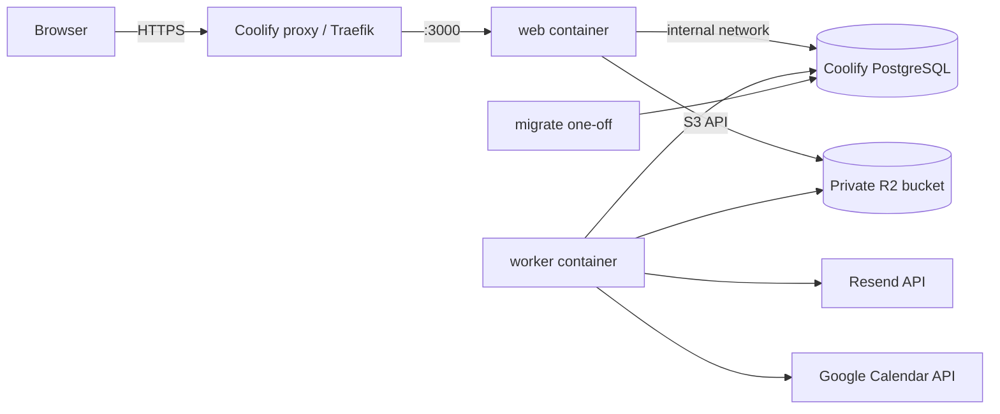

# Deploying JobTrack on Coolify

JobTrack runs as three containers from one `Dockerfile`, orchestrated by `compose.prod.yml`:

| Service   | Image target | Role                                                                                                        | Ports                                             |
| --------- | ------------ | ----------------------------------------------------------------------------------------------------------- | ------------------------------------------------- |
| `migrate` | `migrate`    | One-off: `prisma migrate deploy` then `graphile-worker --schema-only`. Must exit 0 before the others start. | none                                              |
| `web`     | `web`        | Next.js standalone server, non-root, health checks on `/api/health` and `/api/health/ready`.                | 3000 (internal; Coolify's proxy terminates HTTPS) |
| `worker`  | `worker`     | Graphile Worker: reminders, email, calendar sync, file cleanup. Non-root, heartbeat health check.           | none                                              |

PostgreSQL is a **separate Coolify database resource** (not in the compose file). Documents live in a **private
Cloudflare R2 bucket**. Nothing user-generated is written to container disks.



## 1. Prerequisites

- An Ubuntu VPS with Coolify installed and a domain pointing at it (for example `jobs.example.com`).
- A Git repository Coolify can pull (GitHub App or deploy key).
- A Cloudflare account for R2, a Resend account with a verified sending domain, and (optional) a Google Cloud
  project for Calendar.

## 2. PostgreSQL (Coolify database resource)

1. In the same Coolify project and environment: **+ New → Database → PostgreSQL** (version 17 or 18).
2. Leave **Make it publicly available** OFF. JobTrack only needs the internal network.
3. Note the **Postgres URL (internal)**, e.g. `postgres://postgres:<password>@<db-uuid>:5432/postgres`.
4. Optional but recommended: create a dedicated database and role instead of using the superuser:

   ```sql
   CREATE ROLE jobtrack LOGIN PASSWORD '<strong password>';
   CREATE DATABASE jobtrack OWNER jobtrack;
   ```

   Then use `postgres://jobtrack:<password>@<db-uuid>:5432/jobtrack` as `DATABASE_URL`.

5. Configure scheduled backups for this resource (see `docs/BACKUP_AND_RECOVERY.md`).

## 3. Cloudflare R2 (documents)

1. Create a bucket, e.g. `jobtrack-documents`. Do **not** enable public access or a public `r2.dev` URL.
2. Create an R2 API token with **Object Read & Write** limited to that bucket.
3. Values: `S3_ENDPOINT=https://<account-id>.r2.cloudflarestorage.com`, `S3_REGION=auto`, `S3_BUCKET`,
   `S3_ACCESS_KEY_ID`, `S3_SECRET_ACCESS_KEY`.

Downloads are served through `/api/documents/<id>/download`, which checks ownership and redirects to a presigned
URL valid for 60 seconds. The browser talks to R2 only for that redirect.

## 4. Resend (email)

1. Verify your sending domain in Resend and create an API key (sending access only).
2. Set `RESEND_API_KEY` and `EMAIL_FROM` (e.g. `JobTrack <noreply@jobs.example.com>`).
3. Optional bounce handling: in Resend → Webhooks, add `https://jobs.example.com/api/webhooks/resend` for
   `email.bounced` and `email.complained`, and set `RESEND_WEBHOOK_SECRET` to the signing secret (`whsec_...`).

`RESEND_API_KEY` and `EMAIL_FROM` are required: without them nobody can verify their account or reset a password.
`compose.prod.yml` refuses to start until both are set.

## 5. Google Calendar (optional)

1. Google Cloud Console → enable **Google Calendar API**.
2. OAuth consent screen: add scopes `openid`, `email`, `.../auth/calendar.events`,
   `.../auth/calendar.calendarlist.readonly`. Publishing to arbitrary users may require Google verification.
3. Create an **OAuth client ID** (Web application) with the authorized redirect URI
   `https://jobs.example.com/api/integrations/google/callback`.
4. Set `GOOGLE_CLIENT_ID` and `GOOGLE_CLIENT_SECRET`. Without them the Integrations page shows "Not configured" and
   everything else keeps working.

## 6. Create the application in Coolify

1. **+ New → Application → (your Git source)**, choose the repository and branch, **Build Pack: Docker Compose**,
   compose file `compose.prod.yml`.
2. In the resource's **General / Advanced** settings enable **Connect to Predefined Network** so the containers can
   resolve the database's internal hostname.
3. **Domains:** assign `https://jobs.example.com` to the `web` service on port `3000`. Leave `worker` and `migrate`
   without domains.
4. **Environment variables** (Coolify lists every `${VAR}` from the compose file). Generate secrets locally:

   ```bash
   openssl rand -base64 32   # BETTER_AUTH_SECRET
   openssl rand -base64 32   # TOKEN_ENCRYPTION_KEY (must decode to exactly 32 bytes)
   ```

   | Variable                                                                  | Example / note                                                                                                                  |
   | ------------------------------------------------------------------------- | ------------------------------------------------------------------------------------------------------------------------------- |
   | `APP_URL`                                                                 | `https://jobs.example.com` (no trailing slash)                                                                                  |
   | `DATABASE_URL`                                                            | internal URL from step 2                                                                                                        |
   | `BETTER_AUTH_SECRET`                                                      | 32+ random characters                                                                                                           |
   | `TOKEN_ENCRYPTION_KEY`                                                    | base64 of 32 random bytes; rotating it invalidates stored Google tokens                                                         |
   | `TRUSTED_IP_HEADER`                                                       | `x-real-ip` (Traefik). Use `cf-connecting-ip` if Cloudflare proxies the domain                                                  |
   | `RESEND_API_KEY`, `EMAIL_FROM`, `RESEND_WEBHOOK_SECRET`                   | see step 4                                                                                                                      |
   | `S3_*`                                                                    | see step 3                                                                                                                      |
   | `GOOGLE_CLIENT_ID`, `GOOGLE_CLIENT_SECRET`                                | optional                                                                                                                        |
   | `EXTENSION_IDS`                                                           | optional: Chrome extension IDs allowed to connect, comma separated (step 10)                                                    |
   | `GEMINI_API_KEY`                                                          | optional: turns on Improve with AI. Use a key from a Google project with billing enabled (free-tier prompts are used by Google) |
   | `AI_MODEL`                                                                | optional: Gemini model id, default `gemini-3.8-flash`. Change it here and redeploy to switch models                             |
   | `AI_DAILY_REQUESTS_PER_USER`, `AI_MONTHLY_REQUEST_LIMIT`, `AI_TIMEOUT_MS` | optional: defaults 25, 3000 and 20000                                                                                           |
   | `WEB_DATABASE_POOL_MAX`, `WORKER_DATABASE_POOL_MAX`, `WORKER_CONCURRENCY` | defaults 10 / 7 / 5                                                                                                             |

   Mark secrets as **secret** in Coolify so they are hidden in the UI and logs. Never commit `.env` files.

5. **Deploy.** Coolify builds the three targets, runs `migrate`, then starts `web` and `worker` once it exits 0.
6. Check: `https://jobs.example.com/api/health` → `{"status":"ok"}`, `/api/health/ready` → `{"status":"ready"}`,
   and the worker log shows `worker started`.

### Connection pools

Each process keeps one bounded pool (`DATABASE_POOL_MAX`); Graphile Worker uses at most
`min(WORKER_DATABASE_POOL_MAX, WORKER_CONCURRENCY + 2)`. Keep
`web replicas × WEB_DATABASE_POOL_MAX + WORKER_DATABASE_POOL_MAX + 5` below PostgreSQL's `max_connections`
(default 100). The Prisma client is created once per process, never per request.

## 7. Deploying schema changes safely

Migrations run exactly once per deployment in the `migrate` container, never in `web` or `worker`. During a deploy
the old `web`/`worker` containers keep serving until the new ones are healthy, so every migration must be
**backward compatible with the previous release**:

1. **Expand:** add new tables/columns as nullable or with defaults; never rename or drop in the same release that
   starts using the new shape.
2. Deploy code that writes both shapes (or reads the new one with a fallback).
3. **Backfill** in a later migration or a one-off script.
4. **Contract:** drop old columns in a later release, after no running code uses them.

Before a release with a destructive migration, take a manual database backup (see the backup guide). Never run
`prisma db push` or `prisma migrate reset` against production. To check a migration locally:

```bash
pnpm prisma migrate diff --from-config-datasource --to-schema prisma/schema.prisma --script
```

### Rollback

- Code-only problem: redeploy the previous commit in Coolify (migrations already applied are backward compatible).
- Bad migration: restore the pre-deploy backup into a new database, point `DATABASE_URL` at it, redeploy the
  previous commit. Do not hand-edit `_prisma_migrations`.

## 8. Operations

- **Logs:** both services log JSON lines (`level`, `msg`, IDs only; no tokens, emails or resume content).
- **Worker queue:** jobs live in the `graphile_worker` schema. Inspect with
  `select task_identifier, attempts, last_error, run_at from graphile_worker.jobs order by run_at limit 50;`
  Permanently failed jobs remain there (with `last_error`) until removed with
  `graphile-worker --cleanup DELETE_PERMAFAILED_JOBS`.
- **Scaling:** `web` is stateless and can run several replicas. More than one `worker` is safe (jobs are claimed
  with row locks; deliveries are idempotent).
- **Demo data:** `pnpm db:seed` refuses to run in production unless `ALLOW_DEMO_SEED=true`. Only use it on a
  dedicated demo environment.

## 9. Security checklist

- [ ] HTTPS only (Coolify issues certificates); `APP_URL` uses `https://`
- [ ] PostgreSQL not publicly exposed; least-privilege database role
- [ ] R2 bucket private, token scoped to the bucket
- [ ] All secrets set as Coolify secrets, none in Git
- [ ] `RESEND_WEBHOOK_SECRET` set if the webhook is enabled
- [ ] Backups scheduled to off-server storage and a restore tested (see backup guide)
- [ ] `TRUSTED_IP_HEADER` matches your proxy so auth rate limits see real client IPs

## 10. Browser extension (optional)

The "Save to JobTrack" Chrome extension (`extension/`, see `extension/README.md`) talks only to the server it was
built for, and the connect page hands tokens only to extension IDs listed in `EXTENSION_IDS`.

1. Build it for this server: in `extension/.env` set `WXT_JOBTRACK_URL=https://jobs.example.com`, then
   `pnpm ext:build` (or `pnpm ext:zip`).
2. Add its ID to `EXTENSION_IDS` on the Coolify resource and redeploy:
   - unpacked build with the committed dev key: `pdpigjppeaoehfopmcgfdofienlhjjmh` (`pnpm --filter
@jobtrack/extension extension-id` prints the ID for any key);
   - Chrome Web Store build: leave `WXT_EXTENSION_KEY` empty and use the ID the store assigns.
3. Users connect from the extension and can disconnect under **Settings → Browser extension**. Removing an ID from
   `EXTENSION_IDS` stops new connections only; revoke existing ones there or delete rows from `extension_tokens`.
