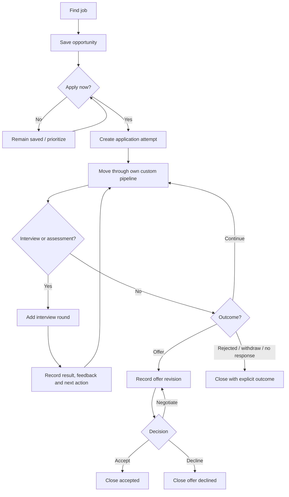
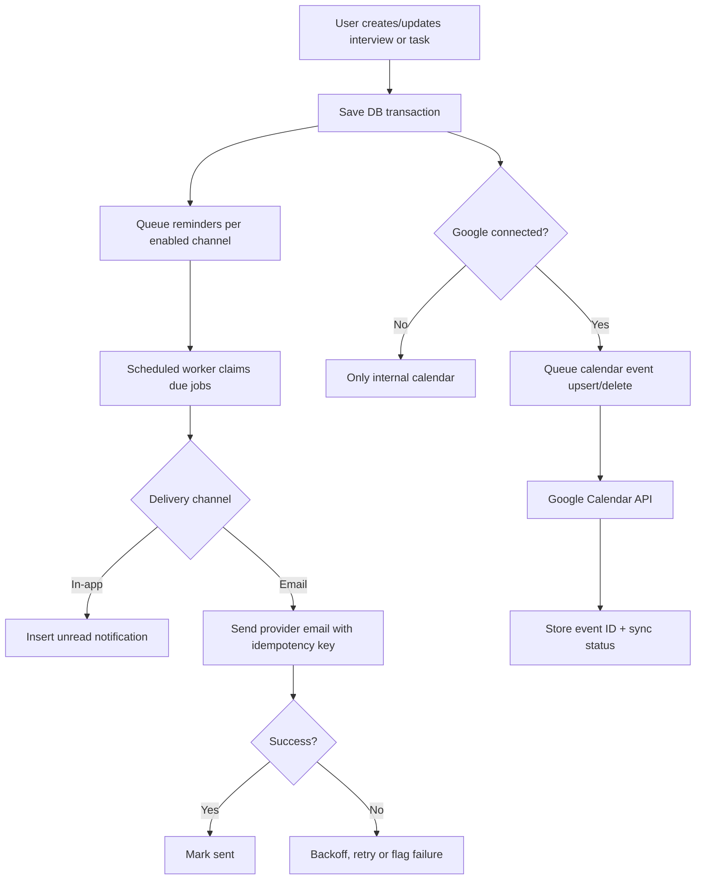
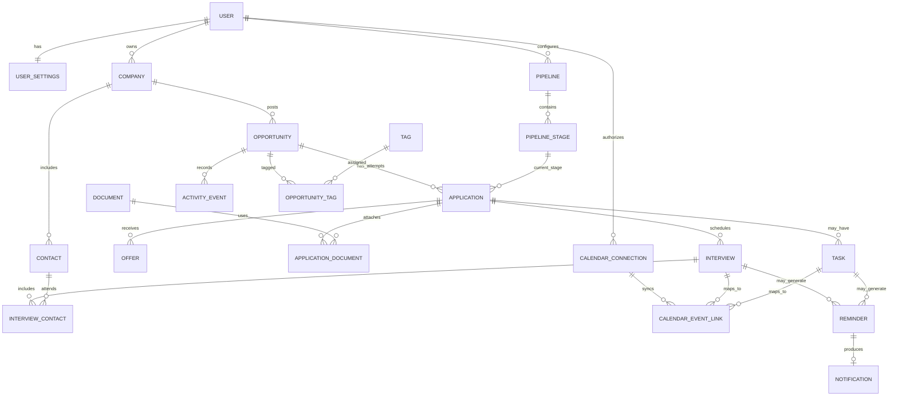

# Job Tracker — Product Requirements Document

**Status:** Implementation-ready planning baseline  
**Version:** 1.0 — 2026-10-14  
**Product:** Multi-user job-search CRM (responsive web)  
**Primary audience:** Individual job seekers, initially including software developers  
**Owner:** Product/development team
**Implementation stack:** Next.js 16 + Prisma ORM 7 + PostgreSQL + Better Auth; Coolify/Docker Compose production deployment.

## 1. Executive summary

Job Tracker helps job seekers capture opportunities, track each application attempt through a customizable hiring pipeline, organize unlimited interview rounds, retain the submitted version of each resume/cover letter, and get clear next actions. Its differentiator is low-friction entry plus accurate, chronological history—not speculative AI automation. Every signed-in user has an isolated personal workspace. The product can grow into a subscription SaaS later but billing is out of initial scope.

## 2. Problem and opportunity

Candidates accumulate jobs across company career sites, referrals, LinkedIn and recruiters. Spreadsheets frequently lose interview changes, resume versions, recruiter contacts, response dates and follow-up tasks. This creates uncertainty, missed follow-ups and poor visibility into search effectiveness. A usable tracker must (1) be fast enough to update after each interaction and (2) present actions rather than just counts.

## 3. Goals and non-goals

### Goals

- Save a new opportunity with only company and title required.
- Track multiple applications to the same opportunity (reapplications); preserve all prior histories.
- Support configurable pipeline stages and unlimited interviews/assessments.
- Make outstanding actions, interview events and due dates visible on the first dashboard screen.
- Offer **opt-in** in-app and email reminders and **opt-in one-way** Google Calendar publishing.
- Retain the exact submitted document versions, not just the candidate's latest file.
- Give each user data export, secure deletion, and ownership boundaries.
- Offer useful application/interview/offer analytics with accurate denominators.

### Non-goals through Release 2

- Automatic applications to employers; AI ranking or interview generation.
- Automatic scraping/parsing of job boards; browser extension.
- Reading Gmail/Outlook inboxes or sending emails to recruiters automatically.
- Two-way calendar sync, calendaring arbitrary personal events, or applicant tracking for hiring teams.
- Team workspaces, collaboration, billing, subscriptions, native iOS/Android applications.
- Aggregated job-market salary benchmarking or live FX conversion.

## 4. Product release boundaries

| Release | Scope | Launch readiness |
|---|---|---|
| R1 — Core Tracker | Account registration/verification/reset; settings/onboarding; company and opportunity CRUD; apply/reapply; pipelines and stages; unlimited interviews; tasks; timeline; table/Kanban/dashboard; basic filtering | Small beta / private launch |
| R2 — Productivity | Resume/cover letter storage and application links; contacts; offers; in-app/email reminders; Google Calendar one-way sync; calendar page; CSV export/import; analytics; privacy/export/delete; operational monitoring | Public feature-complete launch |
| R3 — Automation (later) | URL extraction, browser extension, AI job-to-resume matching, assisted interview preparation, optional 2-way calendar support | Separate roadmap |

R1 still provides manual in-app scheduling and task dates. R2 adds external notification deliveries and calendar integration.

## 5. Users, permissions and onboarding

**User:** A registered individual with a private set of companies, saved jobs, applications, stages, interviews, documents, contacts and preferences. No cross-user sharing in R1/R2. **System operator:** Technical/admin access required for support/operations only; access to private user content must be restricted and audited by policy (no built-in admin browse-all feature).

**Onboarding flow:** register -> verify email -> sign in -> select IANA timezone + currency -> create `user_settings` and default pipeline/stages in one transaction -> add first saved job -> optional opt-in email reminders -> optional Google Calendar connection. On signup failure, onboarding can be retried idempotently. Registration requires rate limits/abuse controls and password reset.

### Default pipeline (user editable)

1. Applied (`applied` category)
2. Recruiter screening (`screening`)
3. Assessment (`assessment`)
4. Technical interview (`interview`)
5. Final interview (`interview`)
6. Offer (`offer`)

Saved opportunities without any application are not in an application's pipeline. User-created stages can be inserted, reordered or renamed and have a stable, non-editable category for analytics. Disabling a stage must not remove historical records. A stage in use cannot be hard-deleted until dependent applications are moved. A changed stage label should not rewrite historical activity event text.

## 6. Information architecture / screens

| Route | Core UI | Primary interactions |
|---|---|---|
| `/login`, `/register`, `/forgot-password` | Authentication, verification and reset | Sign in / recover account |
| `/onboarding` | Timezone, currency, default pipeline, first job | Create defaults |
| `/dashboard` | 4–6 summary metrics, upcoming interviews, overdue tasks, stale applications | Go to next action |
| `/jobs` | Searchable/sortable table + Kanban toggle, filters, quick add | Save, archive, view, apply |
| `/jobs/[id]` | Job description, salary, notes, tags, application attempts | Edit, apply/reapply |
| `/applications/[id]` | Stage, interviews, offers, documents, activity timeline, tasks | Progress, schedule, close |
| `/calendar` | Month/week/agenda view, internal task/interview dates | Edit own items |
| `/tasks` | Due/overdue/upcoming/completed lists | Mark done, edit, snooze |
| `/documents` | Private resume and letter library with versions | Upload, view, attach |
| `/analytics` | Date ranges, application funnel, response times, source breakdown | Filter and export |
| `/settings/pipeline` | Rename, reorder, add, disable stages | Customize stages |
| `/settings/notifications` | Reminder settings and consent | Enable/disable channels |
| `/settings/integrations` | Calendar OAuth account connection/status | Connect/revoke |
| `/settings/account` | Personal settings, export/delete | Privacy and security |

Desktop supports dense table view; mobile uses cards plus accessible filters. Avoid infinite forms; only company and title are required to save a job.

## 7. Detailed functional requirements

### F01 — Opportunity capture and management [R1]
- Quick Add asks for job title and company; optional URL, salary, work arrangement, location, notes.
- Advanced details include job description, responsibilities/requirements, source, employment type, salary range, currency, pay period and gross/net basis, reference code, deadline, and priority (1–5).
- Save even when candidate has not yet applied; display `Saved` based on the absence of an application, not as an application pipeline stage.
- Warn (not block) on potentially duplicate company/title/normalized URL. Allow positions from the same company and reapplications.
- Archive is reversible. Deletion requires confirmation; company deletion must not accidentally wipe live application histories.
- Search by title/company and filter by stage, source, work mode, salary, priority, archived and active status. Salary range comparisons require the same currency/pay period unless the user explicitly normalizes them. At least one persisted view (table/Kanban).

### F02 — Applications and custom pipeline [R1]
- Create an application attempt linked to an opportunity; record true **DATE** of submission (`applied_on`), submitted via/source, selected pipeline and stage.
- Each user gets one default pipeline on onboarding, with option to add others in a later UI iteration; schema already supports multiple.
- User can add/rename/reorder/disable stages, choose a stable stage category, and have unlimited steps. Never encode user stages as a DB enum. The Kanban Saved column is virtual for opportunities without applications; all other Kanban cards represent application **attempts**, with submission date visible when more than one attempt exists.
- Transition stage only to a stage owned by the same user in the same pipeline. Update application and append an immutable activity event **within one DB transaction**.
- Status: `active`, `paused`, `closed`. A closed application requires an outcome: `accepted`, `rejected`, `withdrawn`, `offer_declined`, `no_response`, `role_cancelled`.
- No auto-rejection after silence. `no_response` is explicitly user selected. Reopening a closed application resets its outcome/closed timestamp and logs an event.
- Preserve earlier attempts when a user reapplies.

### F03 — Unlimited interview rounds [R1]
- Add an arbitrary number of interview/assessment records per application. Kind can be technical, screening, behavioral, assessment, final or a custom label.
- Capture date/time/timezone, format, meeting link/place, round number, interviewers, status, result, preparation notes and feedback.
- Support draft interviews with unknown time; scheduled interviews require start time and may include end time; enforce end > start.
- Changing interview date/time retains the same interview record; append a `interview_rescheduled` activity event showing the previous and new times.
- Completed interview can have `pending` result until feedback arrives. Cancellation does not mean candidate rejection.

### F04 — Tasks and activity timeline [R1]
- Create independent tasks or link to a job/application; task types: follow-up, apply, prepare and other.
- Task fields: title, optional description, due timestamp, status, completion timestamp.
- Dashboard sorts overdue first, then imminent interviews, then upcoming tasks and stale-but-still-active applications.
- Timeline records applying, stage movement, interviews scheduled/completed/rescheduled, follow-ups, offer decisions, explicit `employer_response_received` events and manually added notes. Preserve occurrence time and create time; if the first response was never recorded, analytics shows an unknown response time rather than inventing one.
- Suggested follow-up is created only with the user's confirmation or if explicitly enabled by preference; default 7 days is a proposal, not an email sent to an employer.

### F05 — Documents and contacts [R2]
- Upload PDF or DOCX (recommended maximum 10 MB per file; configurable); validate MIME and signature, scan for malware, use private object storage, and issue short-lived signed download URLs.
- Store original name, MIME, size, type, version label, optional SHA-256 and storage key; never make public URLs permanent.
- Attach one or several documents to an application with `purpose` and `was_submitted`; preserve the exact version used even if a newer resume is uploaded.
- Maintain private recruiter/interviewer contacts by company and link them to interview records.
- Delete or replace uploaded files deliberately; avoid breaking attachment history unintentionally. If an attached document is deleted, warn user that historical reference will disappear.

### F06 — Offers [R2]
- Capture salary/period/currency/gross-net, possible bonus, benefits, offered time, decision deadline, status and negotiation notes.
- Represent revisions using `revision_number`; do not silently overwrite earlier offer amounts.
- Accepting/declining offers updates the application outcome in a transaction, with an activity event. Do not auto-close competing applications.

### F07 — Notifications and reminders [R2]
- User can enable or disable email reminders separately; in-app on by default, email off by default until opt-in and email verification.
- Each reminder is tied to exactly one task or interview and to exactly one delivery channel (in-app/email). Separate records per channel; dedupe with per-user unique key.
- Worker processes due reminders using claim/lease, bounded retries, exponential backoff and idempotent provider sends; handles failures without duplicate delivery.
- When events are moved/cancelled, previously pending reminders are rescheduled/cancelled, not sent at obsolete times.
- UI supports read/unread, mark all read, alert preference editing and a visible reminder log/status.
- Transactional auth messages (verify/reset) are separate from optional job follow-up reminders.
- Resend (or comparable email API) and verified sending domain are implementation choices; record provider delivery failures and bounce/complaint webhooks.

### F08 — Google Calendar integration [R2]
- Dedicated *Connect Google Calendar* OAuth authorization in settings; login with Google **does not imply** calendar permission.
- Publish scheduled interviews and opted-in dated tasks to a chosen calendar; use **one-way app-to-Google sync** initially.
- Create/update/delete the same calendar event when the underlying interview/task changes, keeping remote event ID and sync status. Use stable external IDs/idempotency where possible.
- Do not import personal events, invite interviewers, or email guests. Respect calendar visibility and clearly state that shared calendars could reveal interview information.
- Show connected account, sync errors, retry controls and disconnect/revoke. Encrypt refresh/access tokens at rest and request the narrowest functioning scope.
- Changes made directly in Google Calendar do **not** update the tracker during this release; clearly tell users the tracker is source of truth.
- For non-Google users, provide a download `.ics` event as a fallback (can be moved into R2 stretch scope).

### F09 — Analytics and import/export [R2]
- Dashboard data: saved opportunities, active applications, interviews scheduled this week, overdue tasks, pending offers.
- Date-filtered analytics: submitted applications, interview invitation rate, offers rate, first response time and source effectiveness.
- Interview invitation rate uses distinct applications that received at least one interview, divided by submitted applications from selected submission cohort; show pending/open cohort caveats.
- Offer rate uses distinct applications that received an offer, divided by submitted applications in cohort. Do not count multiple offer revisions as multiple offers.
- Provide CSV download for human-readable application data and JSON structured export for user backup. Plan versioned CSV import with mapping, validation and duplicate warnings.
- Archive/closed data remains available in history and optional filters; analytics specify whether closed applications are included.

## 8. User journeys (Mermaid)

### A. Saved job -> application -> outcome

### B. Reminder and one-way calendar flow

## 9. ER diagram

## 10. Application invariants and edge cases

1. **Tenancy:** Every owned table references Better Auth `user.id` (text). Composite FKs disallow cross-user references. API queries also include `WHERE user_id = session.user.id`.
2. **Duplicate positions:** Same company and title is allowed, as is a new application to the same job. Show duplicate warning but no accidental uniqueness constraint.
3. **Custom stages:** Cannot move an application to a stage outside its pipeline or owner. Stage changes and activity events commit together.
4. **State consistency:** Active/paused applications have no final outcome or closedAt; closed applications always have both. Stage remains the last meaningful stage.
5. **Interview scheduling:** `starts_at` and `ends_at` are UTC instants in `TIMESTAMPTZ`; persist IANA zone string; prevent `end <= start`.
6. **Backdating:** `applied_on` and `closing_on` are SQL DATE without timezone conversion. Late data entry is allowed.
7. **Reminders:** When scheduled interview changes, cancel/replan pending deliveries; preserve sent history and audit log. Worker may attempt retries but must use stable dedupe keys/provider idempotency.
8. **Calendar:** OAuth denial, revoked token, rate limiting, deleted external event and permission changes cannot invalidate or erase internal interview records.
9. **Documents:** Public download is impossible without an authenticated, owner-scoped, short-lived signed request. Uploaded bytes and token secrets are never placed in analytics/event metadata.
10. **Account deletion:** Delete accessible user data including object-storage bytes and OAuth tokens, revoke connections where feasible; document backup retention and exceptions. Handle FK/delete order in a test transaction.
11. **Data portability:** Export includes all opportunities, applications, interviews, tasks, notes, stage mapping and file metadata, with download of original documents handled separately.
12. **Partial integration failures:** Email/calendar may fail while the application mutation succeeds; surface their independent retry state.

## 11. Non-functional requirements

| Area | Requirement |
|---|---|
| Security | HTTPS/TLS; validated sessions; authorization on every mutation/query; least-privilege DB role; input validation; rate limits on public/auth endpoints; security headers |
| Uploads | Private bucket, allowlist MIME/signature, max size, antivirus scan, signed URLs, content-disposition download |
| Privacy | Clear privacy/retention policy, opt-in email and calendar, data export/deletion, minimal operational logging, encrypted OAuth credentials |
| Performance targets | p95 internal CRUD under 500 ms at baseline test load, useful dashboard in ~2 seconds on reference hardware/network (targets, not guarantees) |
| Reliability | Durable DB migration/rollback plan, backups + restore test, retryable integrations, monitoring and alerting |
| Accessibility | Aim for WCAG 2.2 AA; keyboard usable table/Kanban, accessible dialogs, visible validation and focus states |
| Internationalization | UI initially English; currency and dates vary by user locale, user timezone supported |
| Browser support | Recent Chrome/Edge/Firefox/Safari; responsive mobile web |
| Observability | Error rate, worker queue depth, reminder delivery latency, calendar sync errors, sign-up conversion—without logging descriptions/resumes/tokens |

## 12. Success criteria and launch gates

**Product targets (to be measured, not promises):**

- New users can save their first job with no more than two required text fields.
- Median experienced user can quick-add a job in less than 30 seconds in usability tests.
- 95%+ of scheduled reminders are processed within a 5-minute delivery window when the provider is healthy; measure separately per channel.
- No duplicate notification generated for the same reminder idempotency key, even under concurrent worker tests.
- Zero cross-user read/write/download access in automated authorization tests.
- Core create/edit/close/reapply/reschedule workflows complete successfully in desktop and mobile E2E tests.

**Public launch gates:** email verification/reset verified; user isolation pen-tested; data export/deletion tested; scheduled worker persistent; reminders and integration reconnection tested; privacy/terms available; monitored backup restore and operational runbook; Google OAuth verification/consent readiness confirmed for public users.

## 13. Open but non-blocking decisions and defaults

- **Google Calendar** as the first provider; Microsoft Outlook is later. One-way sync avoids early conflict-resolution complexity.
- **Resume files** limited to PDF/DOCX and 10 MB each initially; policy is configurable.
- **Default reminder lead**: 24 h before an interview and suggested follow-up 7 days after applying. User can change both.
- **Notifications:** in-app on; reminder email off until explicitly enabled by a verified user; calendar disconnected until consent.
- **Salary**: exact numeric amount strings, currency as ISO 4217, hourly/daily/weekly/monthly/annual period, optional gross/net; never auto-compare different currencies or pay periods without conversion rules.
- **Deployment:** self-hosted VPS with Coolify and Docker Compose. Use a separate Coolify-managed PostgreSQL database with off-server encrypted backups, Graphile Worker, and private S3-compatible document storage.

## 14. References (consulted October 2026)

- Better Auth database/Prisma adapter: https://better-auth.com/docs/concepts/database and https://better-auth.com/docs/adapters/prisma
- Prisma ORM: https://www.prisma.io/docs/orm and PostgreSQL constraints: https://www.postgresql.org/docs/current/ddl-constraints.html
- Next.js Server Action security: https://nextjs.org/docs/app/getting-started/mutating-data
- Google Calendar events/scopes: https://developers.google.com/workspace/calendar/api/guides/create-events and https://developers.google.com/workspace/calendar/api/auth
- Google sync mechanics: https://developers.google.com/workspace/calendar/api/guides/sync
- Resend idempotency: https://resend.com/changelog/idempotency-keys